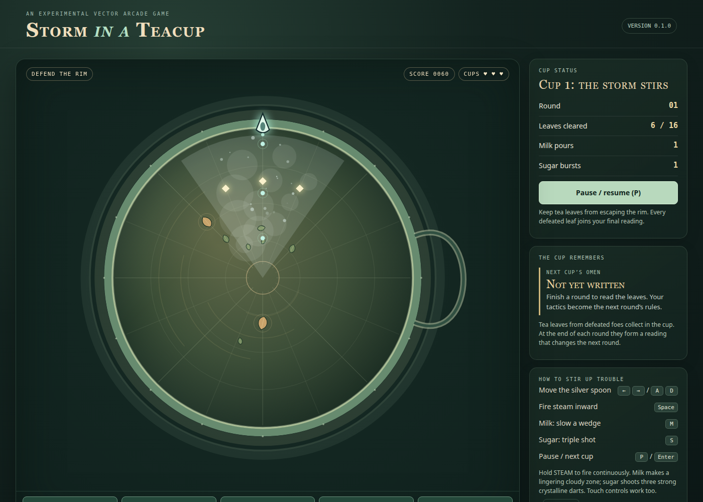

# Steeped in Trouble

An original, experimental, tea-themed vector arcade game. Defend the rim of a
stormy teacup with a silver spoon, fire steam at rising tea leaves, and use
milk and sugar wisely. The leaves you defeat settle in the cup, and their
pattern is read as a fortune that changes the next round.

**[▶ Play it in your browser](https://libertaine.github.io/Steeped-in-Trouble/)**



## Status

Version **0.2.0 — The Living Teacup**: the tea in the cup now drifts,
ripples, and reacts to play, with a High/Low graphics toggle. Gameplay matches
the [reference prototype](docs/reference/README.md). Expect frequent
experimental changes in later versions.

The game was called *Storm in a Teacup* up to version 0.1.0.

## Controls

| Action | Keyboard | Touch |
| --- | --- | --- |
| Move the silver spoon | <kbd>←</kbd> <kbd>→</kbd> or <kbd>A</kbd> <kbd>D</kbd> | hold **◀ TURN** / **TURN ▶** |
| Fire steam (hold for continuous fire) | <kbd>Space</kbd> | hold **STEAM ↑** |
| Milk: slow a wedge of the cup | <kbd>M</kbd> | **MILK** |
| Sugar: three-lane burst | <kbd>S</kbd> | **SUGAR** |
| Pause / resume | <kbd>P</kbd> | main button |
| Start, next cup, new pot | <kbd>Enter</kbd> | main button |
| Restart after game over | <kbd>R</kbd> | main button |

Sound is off by default. Use the **Sound** toggle to enable it.

Add `?seed=<number>` to the URL to replay the same sequence of tea leaves.

The **Graphics** toggle switches the tea between high quality (full-resolution
liquid with glowing currents) and low quality for older machines. You can also
add `?graphics=low` or `?graphics=high` to the URL.

## Running locally

Prerequisites: [Node.js](https://nodejs.org/) 24 LTS (22.12 or newer also
works) and npm, which ships with Node.js. The project works on Windows,
macOS, and Linux.

```bash
git clone https://github.com/libertaine/Steeped-in-Trouble.git
cd Steeped-in-Trouble
npm ci
npm run dev
```

Then open the URL Vite prints (normally
<http://localhost:5173/Steeped-in-Trouble/>).

## Development commands

| Command | Purpose |
| --- | --- |
| `npm run dev` | Development server with hot reload |
| `npm run build` | Production build into `dist/` |
| `npm run preview` | Serve the production build locally |
| `npm run lint` | ESLint |
| `npm test` | Unit tests (Vitest) |
| `npm run test:watch` | Unit tests in watch mode |
| `npm run test:browser` | Browser smoke tests (Playwright) against a fresh production build |
| `npm run check` | Lint, unit tests, and build in one go |

Before running browser tests for the first time, install the browsers:

```bash
npx playwright install chromium firefox
```

On Linux you may also need `npx playwright install-deps` (requires sudo).

To smoke-test the published site instead of a local build:

```bash
BASE_URL=https://libertaine.github.io/Steeped-in-Trouble/ npm run test:browser
```

On Windows PowerShell, run `$env:BASE_URL="https://libertaine.github.io/Steeped-in-Trouble/"; npm run test:browser`.

## Project documentation

- [Architecture](docs/ARCHITECTURE.md): how the code fits together and how to
  add enemies, weapons, and fortunes
- [Game design](docs/GAME_DESIGN.md): creative direction, current mechanics,
  and future ideas
- [Development](DEVELOPMENT.md): how we work on the game
- [Contributing](CONTRIBUTING.md): development workflow
- [Reference prototype](docs/reference/README.md): the preserved original and
  its differences from 0.1.0
- [Changelog](CHANGELOG.md)

## Feedback

Bug reports and ideas are welcome in
[GitHub Issues](https://github.com/libertaine/Steeped-in-Trouble/issues).

## License

[MIT](LICENSE). All artwork is drawn procedurally with Canvas paths, and all
sound is synthesized at runtime. The game uses no third-party art, fonts,
audio, or runtime libraries, and it is not affiliated with or adapted from
any commercial arcade game.
