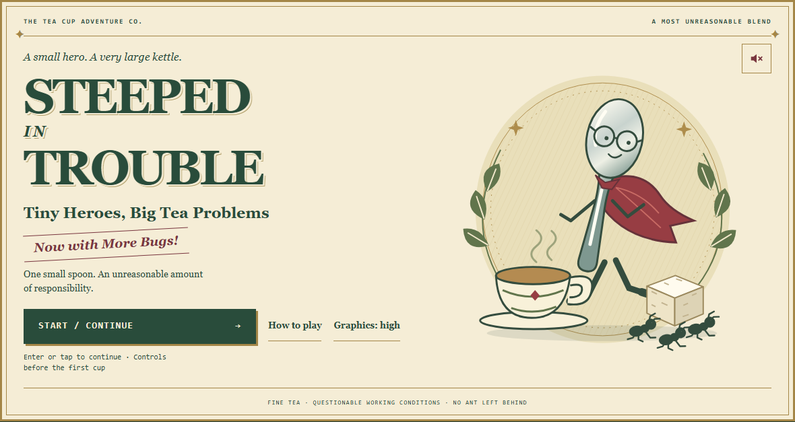
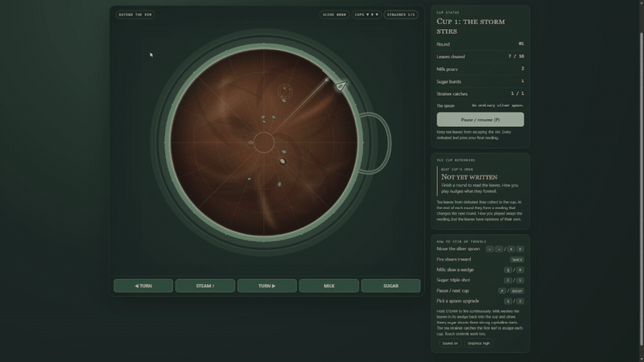

# Steeped in Trouble

**One small spoon. An unreasonable amount of responsibility.**

Defend a temperamental teacup with steam, milk and sugar, upgrade your silver
spoon, and read tea-leaf fortunes that change the next cup. Optional little
adventures and unexpected humor keep finding their way into the pot.

**[▶ Play it in your browser](https://libertaine.github.io/Steeped-in-Trouble/)**



*A first cup's basic mechanics: steam, milk and sugar. This earlier recording
does not show all current features.*
Prefer a still image? [See a screenshot](docs/images/screenshot.png).

## 0.22.0 — The Training Cup

- An optional Training Cup teaches movement, steam, milk and sugar, then runs
  a short practice wave.
- The former Compact layout is now the only responsive presentation, with
  improved Day and Tea Shortage choices in narrow windows.
- Analytics now load as an optional module, so blocking them cannot stop the
  game from starting. See [Privacy](#privacy), including how to turn them off.

Normal gameplay and earlier saved pots are unchanged.

See the [release notes](docs/releases/v0.22.0.md),
[changelog](CHANGELOG.md) and
[past releases](https://github.com/libertaine/Steeped-in-Trouble/releases).

## What's in the pot

- **Teacup arcade defense:** living tea, distinct brews, spoon upgrades,
  fortunes influenced by your play, and increasingly unreasonable opponents.
  Mushroom Tea and its Mycelium Manager await later chapters.
- **Optional mini-adventures:** The Tea Run, The Daily Pour, Biscuit Breakout
  and Crossing the Street. Skip them freely during a pot, or jump straight
  into **The Spoon's Other Jobs** to chase browser-local personal records.
- **Days and Chapters:** every ten normal cups, choose a gentler Fresh Brew
  or carry the Heat forward. Days control difficulty; Chapters open content.
- **Continue Your Pot:** completed normal cups save automatically. Return to
  the last reading and pending choices; mid-round positions are not saved.
  Progress and arcade records stay in this browser on this device. Clearing
  browser data may erase them; there is no account or cloud synchronization.
- **Room for tea:** one responsive layout, Easy and Classic Touch, optional
  Auto Steam, an illustrated resource HUD, and an adaptive synthesized score.

Desktop browsers with keyboard controls are the primary experience. Phone
and tablet support is best effort; mobile checks primarily use browser
emulation. Extended human playtesting and physical-device testing remain open.

## How to play

- Tea leaves drift out from the centre of the cup. Each one that reaches the
  rim spills, costing one of your three cups. The cup's condition, from CUP
  STABLE to STRUCTURAL FAILURE IMMINENT, shows how many it can still afford.
  Lose them all and the cup breaks.
- The spoon circles the rim and fires down the lane that glows. Steam is
  unlimited. Each round you also get a couple of milk pours, which push
  leaves back and slow them (strongly in front of the spoon, and briefly
  across the whole cup), and a couple of sugar bursts, which fire down three
  lanes at once.
- Clear enough leaves to finish the round. The leaves you defeated are then
  read, and their fortune changes the next round. Every other round you also
  choose an upgrade for your spoon, which lasts for the whole pot.
- Each round brews a tea, and each tea changes how the leaves behave. The
  cup announces it, and the side panel says what it does. New teas join the
  shelf as you progress.
- The game doesn't simply speed up every round. It moves on in chapters,
  when you've earned it.
- Now and then something different happens between cups. The side panel
  explains what to do, and none of it costs a cup.
- Experiment. The cup rewards curiosity, and some things are best found for
  yourself. The full rules are in [docs/GAME_DESIGN.md](docs/GAME_DESIGN.md),
  spoilers and all.

## Controls

| Action | Keyboard | Touch |
| --- | --- | --- |
| Move the silver spoon | <kbd>←</kbd> <kbd>→</kbd> or <kbd>A</kbd> <kbd>D</kbd> | hold **◀ TURN** / **TURN ▶** |
| Fire steam (hold for continuous fire) | <kbd>Space</kbd> | hold **STEAM ↑** |
| Milk: wash back and slow a wedge of the cup, and the whole cup briefly | <kbd>Q</kbd> or <kbd>↑</kbd> | **MILK** |
| Sugar: three-lane burst | <kbd>E</kbd>, <kbd>↓</kbd>, or <kbd>S</kbd> | **SUGAR** |
| Pause / resume | <kbd>P</kbd> | main button |
| Mute / Unmute Audio | <kbd>M</kbd> | speaker button |
| Start, next cup, new pot | <kbd>Enter</kbd> | main button |
| Pick a spoon upgrade | <kbd>1</kbd> / <kbd>2</kbd> | tap a card |
| Restart after game over | <kbd>R</kbd> | main button |
| Tea Shortage: Buy / Run / Skip | <kbd>1</kbd> / <kbd>2</kbd> / <kbd>3</kbd> | tap a choice |
| Tea Run: jump / slide | <kbd>Space</kbd> or <kbd>↑</kbd> / <kbd>↓</kbd> | **JUMP** / **SLIDE** |
| The Daily Pour: Deliver / No thanks | <kbd>1</kbd> / <kbd>2</kbd> | tap a choice |
| The Daily Pour: aim porch / mailbox, throw | <kbd>↑</kbd> / <kbd>↓</kbd>, <kbd>Space</kbd> | **AIM** / **THROW** |
| Biscuit Breakout: Break / Leave them alone | <kbd>1</kbd> / <kbd>2</kbd> | tap a choice |
| Biscuit Breakout: move the spoon, launch the cube | <kbd>←</kbd> <kbd>→</kbd> or <kbd>A</kbd> <kbd>D</kbd>, <kbd>Space</kbd> | hold **◀** / **▶**, **LAUNCH** |
| Crossing the Street: Cross / Stay | <kbd>1</kbd> / <kbd>2</kbd> | tap a choice |
| Crossing the Street: hop (hold to repeat) | <kbd>↑</kbd> <kbd>↓</kbd> <kbd>←</kbd> <kbd>→</kbd> or <kbd>W</kbd> <kbd>A</kbd> <kbd>S</kbd> <kbd>D</kbd> | **▲** **◀** **▼** **▶** pad |

Phones start with **Easy Touch**: hold the two
steering pads, double-tap the cup for milk, and hold the cup for sugar.
Auto Steam fires only at targets lined up with your spoon. Select **Classic
Touch** for the buttons in the table; it also works with Auto Steam.

Mini-adventures explain their controls when offered. Skipping or failing one
never costs a cup. For the complete rules and rewards (with spoilers), see
[Game design](docs/GAME_DESIGN.md).

## Options

- **One responsive layout** puts the HUD above the cup, with reachable
  thumb controls and a **Pause / Menu** button. **The Tea Break**
  holds pot details, tea and fortune explanations, settings, and controls.
  Required upgrade and Buy / Run / Skip choices stay beside the game; the
  leaf reading reveals before details become available. Short landscape
  windows use a control rail beside the cup. The former Compact layout is
  now permanent; saved view preferences and `?view=compact|full` are ignored.
  The game cannot override Chrome's Desktop Site setting.
- **Touch** chooses Easy or Classic Touch; **Auto Steam** can be enabled
  with Classic Touch or a keyboard, and is always enabled with Easy Touch.
  Both choices are remembered. URL overrides for one visit are
  `?touch=easy|classic` and `?autosteam=on|off` (Easy Touch keeps Auto Steam on).
- **On-screen controls** (Tea Break → Controls & Settings) is Auto by
  default: touch buttons appear on phones and tablets and stay out of the way
  with a keyboard and mouse. **Show** or **Hide** overrides it and is
  remembered; hiding them gives the cup the extra width. Keyboard shortcuts
  and Easy Touch cup gestures always work.
- **Sound** is off by default. Turn it on for synthesized sound effects and
  the adaptive soundtrack with the speaker button (on the title screen, at the
  top of the game, and in the Tea Break), with <kbd>M</kbd> from anywhere, or
  with Sound in Controls & Settings. All three are one switch for music and
  effects together, and the choice is remembered in this browser.
- **Graphics** switches between high quality (full-resolution tea with
  glowing currents) and low quality for older machines. You can also add
  `?graphics=low` or `?graphics=high` to the URL.
- Add `?seed=<number>` to the URL to replay the same sequence of tea leaves.
- Add `?tea=<variety>` to brew only one tea, for practice: `green`,
  `earlGrey`, `chai`, `black`, `herbal`, or `house`. A practice tea is
  available from the first cup.

## Running locally

Prerequisites: [Node.js](https://nodejs.org/) 24 LTS (22.12 or newer also
works) and npm, which ships with Node.js. The project works on Windows,
macOS, and Linux.

```bash
git clone https://github.com/libertaine/Steeped-in-Trouble.git
cd Steeped-in-Trouble
npm ci
npm run dev
```

Then open the URL Vite prints (normally
<http://localhost:5173/Steeped-in-Trouble/>).

## Development commands

| Command | Purpose |
| --- | --- |
| `npm run dev` | Development server with hot reload |
| `npm run build` | Production build into `dist/` |
| `npm run preview` | Serve the production build locally |
| `npm run lint` | ESLint |
| `npm test` | Unit tests (Vitest) |
| `npm run test:watch` | Unit tests in watch mode |
| `npm run test:browser` | Complete Playwright regression against a fresh production build |
| `npm run test:browser:smoke` | Fast Chromium and mobile smoke checks |
| `npm run check` | Lint, unit tests, and build in one go |

Before running browser tests for the first time, install the browsers:

```bash
npx playwright install chromium firefox
```

On Linux you may also need `npx playwright install-deps` (requires sudo).

To run browser tests against the published site instead of a local build:

```bash
BASE_URL=https://libertaine.github.io/Steeped-in-Trouble/ npm run test:browser
```

On Windows PowerShell, run `$env:BASE_URL="https://libertaine.github.io/Steeped-in-Trouble/"; npm run test:browser`.

## Project documentation

- [Architecture](docs/ARCHITECTURE.md): how the code fits together, and how to
  add enemies, weapons, and fortunes
- [Game design](docs/GAME_DESIGN.md): creative direction, the full rules
  (secrets included, so beware of spoilers), and future ideas
- [Day testing](docs/DAYS_TESTING.md): practice shortcuts,
  deterministic tuning and human testing instructions
- [Crossing the Street testing](docs/CROSSING_STREET_TESTING.md): practice
  shortcuts, deterministic replay and testing instructions
- [Arcade Collection testing](docs/ARCADE_COLLECTION_TESTING.md):
  Continue Your Pot and the human playtesting checklist
- [The Cup Remembers testing](docs/CUP_REMEMBERS_TESTING.md): fortune
  explanations, porcelain damage, Golden Leaves, save migration and
  playtesting instructions
- [Analytics](docs/ANALYTICS.md): the exact event contract, privacy behavior and
  limitations
- [Development](DEVELOPMENT.md): principles and full Windows/Ubuntu qualification
- [Contributing](CONTRIBUTING.md): branching, checks, and releases
- [Reference prototype](docs/reference/README.md): the preserved original and
  its differences from 0.1.0
- [Changelog](CHANGELOG.md)

## Privacy

This game uses cookie-free Umami analytics to estimate visits, game starts,
progress milestones, and active playtime. We do not send gameplay inputs,
scores, or saved games. The provider processes limited browser and network
information for aggregate reporting. Add `?analytics=off` to the game URL to
disable analytics: <https://libertaine.github.io/Steeped-in-Trouble/?analytics=off>.

The tracker loads only on the published page. It stays off if your browser
sends Do Not Track, and in local builds and automated tests. The game creates
no analytics identifiers, and its saves and records stay in your browser. Umami's
returning-visitor figures describe returning website visitors, not identifiable
players. See [docs/ANALYTICS.md](docs/ANALYTICS.md) for the details.

## Feedback

Bug reports and ideas are welcome in
[GitHub Issues](https://github.com/libertaine/Steeped-in-Trouble/issues).

## License

[MIT](LICENSE). The original SVG title illustration accompanies procedural
Canvas artwork; sound is synthesized at runtime. The game uses no third-party
art, fonts, audio, or runtime libraries, and it is not affiliated with or adapted from
any commercial arcade game.

## Support the Project

Enjoying Steeped in Trouble? If you'd like to help keep the kettle boiling, you
can [support development via PayPal](https://www.paypal.com/donate/?hosted_button_id=DRJD388WT8DAL).

Contributions are entirely optional. Playing the game, sharing it with others,
and reporting bugs or suggestions are just as appreciated.
