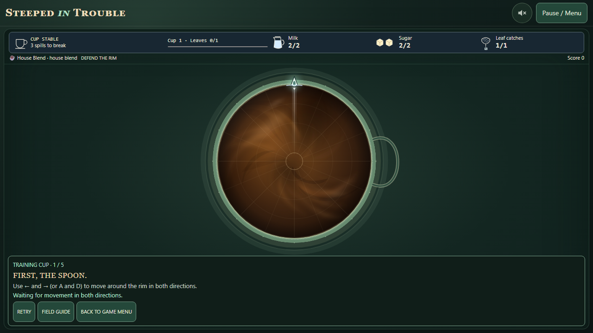
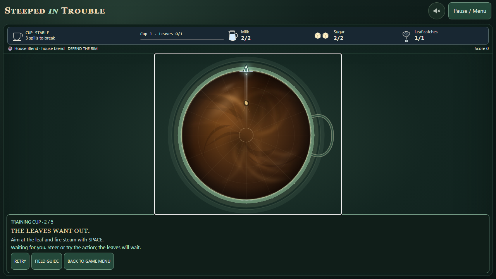
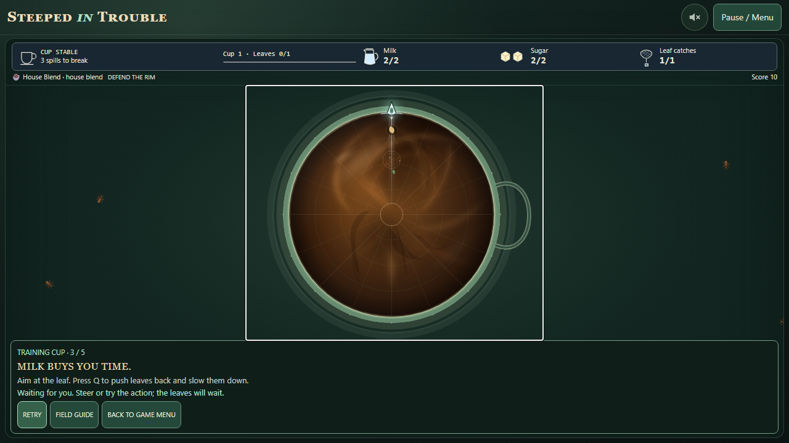
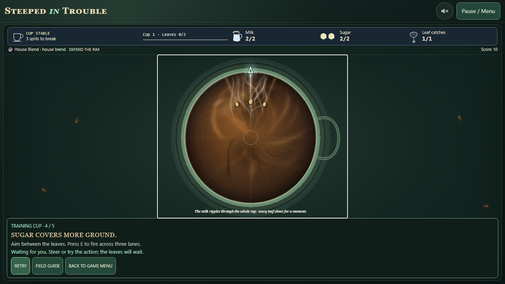
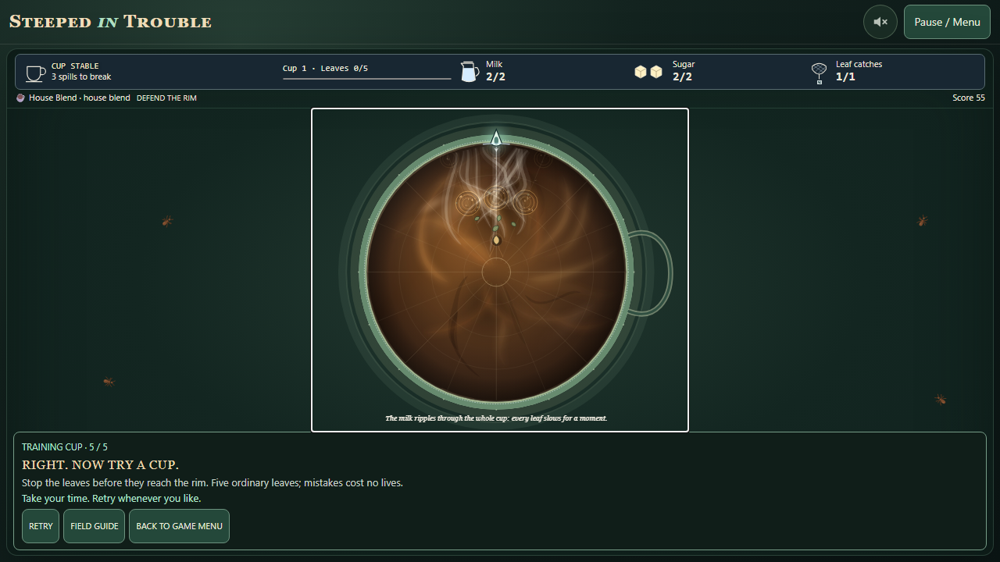
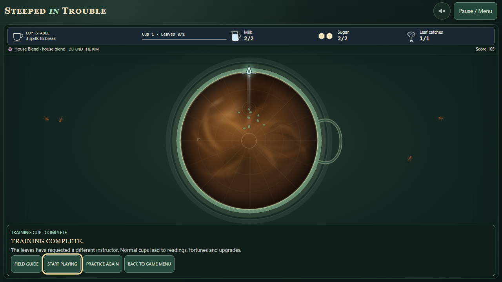

# The Training Cup

Tutorial feature for the eventual 0.22.0 integration. Package version remains 0.21.0.
Stack: `feature/training-cup` targets `feature/single-presentation` (draft PR #48),
starting at exactly `5eb27cccb213e592241a62bf625ce6480e1fbe32`.
Both PRs remain unmerged. This work authorizes no tag, release, Pages deployment or publication.

## Design and implementation

The title, pre-game Field Guide and Tea Break offer TRAINING CUP. Normal start/continue
and the Field Guide remain available. A small panel in the existing choices row sits
outside the canvas and controls; at short landscape sizes it occupies the thumb rail.
The panel has stage text, a persistent action prompt, Retry, Field Guide and Back to Game Menu.
Escape returns to the menu from the cup. Native dialogs retain their normal Escape behavior.
Completion offers Start Playing, Practice Again and Back to Game Menu.

`src/core/training.js` is a focused exercise controller. `createGame({ training })`
retains the ordinary spoon, weapons, clouds, recovery pulse, enemy advancement, hit tests,
kill accounting, visual/audio events and pause behavior. The small training hooks gate
unintroduced weapons, supply fixed targets, suspend enemy movement, observe genuine hits,
replace escaped leaves without normal penalties, and suppress the reading transition.
Normal-game code follows its existing path when no controller is supplied. No damage,
balance, enemy speed, difficulty, save schema or normal spawn rules change.

The stages require:

1. At least 0.22 radians of actual travel in each direction. Zero-time presses and opposing holds do not count.
2. A real steam volley collision with an ordinary leaf in lane 0. Firing into an empty lane does not count.
3. A real milk pour affecting the prepared leaf, followed by at least 0.65 seconds of observed inward movement under the real milk slowdown. The ordinary local cloud and whole-cup recovery pulse are both visible.
4. A sugar dart collision with at least one of three ordinary leaves in neighboring lanes 15, 0 and 1. The ordinary burst launches all three darts. A static lane preview lasts 1.2 simulation seconds and firing uses the existing aim flashes.
5. Five ordinary leaves, one at a time, in lanes 0, 1, 15, 2 and 0. Each must be cleared by real gameplay. Escapes repeat the current target; they do not count as a clear.

Stage 2 places a leaf halfway out, stage 3 at 83% of the radius, stage 4 at 55%.
Placement is controlled; enemy speeds and weapon behavior remain unchanged.
The practice leaves start at the ordinary seeded spawn radii. There is no exercise time limit.
Retry restores that exercise's targets, orientation and charges. Exhausted ineffective milk
or sugar attempts recover automatically; repeated misses display a hint. No action is
performed on the player's behalf.

## Freeze, input and lifecycle

The normal animation loop continues throughout. Enemy advancement is held until the
player steers or attempts the introduced action; automatic spawning is disabled for
the whole training session. Spoon movement and UI stay responsive. Auto Steam waits
for deliberate steering in its exercise, then uses the ordinary targeting and projectiles.
Steam cannot remove the milk or sugar targets during their respective demonstrations.

Success holds the remaining enemies while the completing input is released. A stage
advances only after both the simulation's held controls and the input layer's physical
key/pointer holds are released. Transition cleanup settles input and cancels gestures
and pointer capture. The next stage gets fresh targets and no lingering projectiles.
Delayed presentation events never advance exercises. Pause, reference dialogs, blur and
visibility loss use the existing pause paths. Returning to visibility never resumes by itself.
Stage changes announce their text without opening another modal or moving keyboard focus;
completion focuses its heading and resets the panel scroll position so the result text
appears before the actions. The lane/spoon emphasis uses existing static drawing,
and new UI introduces no independent animation, RAF, or reduced-motion exception.

## Isolation

`createSessions` keeps training in its own slot, separate from both the pot and arcade
practice. The session proxy redirects existing renderer, HUD and input calls to that
disposable game. It does not give the tutorial an arcade-adventure identity or settle
arcade records. Training has fresh state and private random streams, seed `0x7ea1c0`.
Each exercise restarts its controlled-spawn stream at seed plus stage index. No main
seed is requested. Exit drops the instance, including pending events and the controller.
Replay constructs a fresh instance. Main-pot state/RNG and saved storage are retained.

Training exports no checkpoint, never enters a reading or normal game-over path, and
`sessions.handle()` excludes it from storage handling. `sessions.ordinary` gates both
event forwarding to analytics and engagement frames. The analytics adapter and event
contracts remain unchanged; no tutorial telemetry is added. A pageview keeps its existing
privacy rules. Tests also exercise exclusion after normal analytics has already started.

Start Playing returns to the existing pot. From the pre-game ready state it uses the
existing collection primary/start path, so an existing checkpoint is continued. Existing
game-over replacement confirmation remains in charge. A suspended cup resumes; a reading
stays a reading. No tutorial action calls new-pot/clear-pot directly.

## Automated qualification

New coverage is in `tests/unit/training.test.js` and the `tests/browser/training*` files.
It exercises real keyboard and pointer/gesture input against the production build with
the ordinary loop under Playwright's controllable clock. No browser test manufactures
training successes or replaces the movement/collision implementation.

The browser matrix includes Chromium, Firefox and mobile Chromium, both shown Classic
controls and hidden Easy Touch controls, every exercise and completion, fallback monospace
fonts and reduced motion, at 320×568, 375×667, 844×390, 800×600, 1280×720 and 1920×1080.
Separate flows cover visible Classic/Easy pointer controls, Auto Steam, title and Field
Guide entry, retries/replay, pause/reference, focus/background loss, Escape, preserved pot
and RNG, and normal play afterward. Existing regression assertions are retained.

Run `npm run lint`, `npm test`, `npm run build`, then `npm run test:browser`.
The full-regression workflow qualifies the exact feature SHA on Ubuntu and Windows;
see the draft PR for the final SHA, counts, run links and any retries/failures.
Generated historical gallery images must be independently archived and restored before staging.

Development history: the initial unit run found a missing optional-button check in the
older overlay harness; it was fixed. Early browser development caught completion-panel
arena squeezing at 320×568 and conflicting hidden-controls landscape rules at 800×600;
the tutorial now reserves canvas space and scrolls its own row. Test setup initially
provided duplicate URL settings, then assumed Auto Steam cleared exactly one leaf per
helper call; both harness issues were corrected. Sandboxed Firefox crashed before page
load and sandboxed runners could not clean up preview processes; qualification uses
normal browser process permissions, with those failures disclosed separately from product checks.
The first full candidate (`c2a9d88`) exposed an extra Field Guide action row that squeezed
its body and the newly added Tab stop missing from the previous focus-cycle expectations.
That run was stopped after confirmed failures. The secondary actions now share a row;
the existing geometry assertions are retained and include the tutorial button, and the
focus-cycle assertions are extended through that button before checking wraparound.
Visual review of the next candidate (`7e2fc44`) found that focusing Start Playing could
scroll the completion heading out of the smallest touch layout. It now focuses the
heading, all stages reset panel scroll, and layout checks assert the heading begins visible.
Candidate `bc6513d` reached the second shared Field Guide test helper, which also still
expected only two actions. Its focus cycle is extended through Training Cup, and its
existing fixed-part visibility and 44px target checks now cover that button too.
The complete hosted `fe2a60f` run exposed a 2px middle-body shortage with Ubuntu's
Georgia-free fonts at 375×667 (Chromium and Firefox, both repeated on retry).
The action row now uses 4px less vertical spacing, preserving text sizes and 44px buttons;
this exact font/viewport case also joins smoke CI. Windows completed with one flaky
90-second timeout on the 1920×1080 mobile Easy Touch exercise. The browser aiming helper
now holds a real direction key for measured travel rather than making many tiny taps
with idle redraws between them; every action/collision/visibility assertion and the
90-second timeout remain unchanged. These results require fresh qualification.
Direct touch-only review of `3d17a17` then reproduced a recovery gap: closing the
training Field Guide could leave play paused, and background pause hid the ordinary
Resume action. The reference now lets the existing menu own its pause/resume lifecycle;
the ordinary primary button remains visible and functional during paused training.
Both touch schemes test blur → tap Resume and Field Guide → return without keyboard
assistance. The keyboard flow now asserts reference return resumes, rather than using
P to compensate for the paused result. Pot/session behavior remains unchanged.
Actions attempted during pause also leave an unengaged exercise waiting; a unit case
checks that they cannot arm enemy approach for the later resume.

## Representative captures

## Manual evaluation: human pass still required

Browser automation demonstrates mechanics and geometry. It cannot establish whether a
new player understands the game, enjoys the pace, or finds aiming natural. No human
playtest or physical touch-device test is claimed. Use this short protocol with someone
who has not played the game; record their words and any assistance at each point.

| Question | Task/observation to record |
| --- | --- |
| Is the purpose clear afterward? | After completion, ask the player to explain what ends a cup and what a leaf reaching the rim means. |
| Are instructions timely? | Observe all five stages. Record any prompt the player acts on before seeing it, or any target that appears confusingly early. |
| Is aiming/shooting straightforward? | Ask them to hit the steam leaf using their preferred controls, then repeat with Auto Steam. Count retries and verbal help. |
| Is milk understood? | Ask what changed after pouring, then ask when they would use it in a normal cup. Look for both pushback and slowdown. |
| Is sugar distinct from steam? | Ask which lanes each attack covers. Observe whether they can line up a neighboring target without coaching. |
| Can the tutorial be completed without getting stuck? | Include one intentional escape, a missed milk pour and missed sugar bursts; try Retry, Field Guide, pause and exit/re-entry. Record recovery clarity. |
| Is normal play a natural next step? | Select Start Playing with and without an existing saved pot; verify no replacement surprise and ask whether readings/fortunes/upgrades feel appropriately introduced. |

Repeat one run on a physical touch device in Easy Touch and one in Classic Touch, and
check the smallest/shortest layouts with a keyboard and screen reader. In training the
normal HUD remains visible, including its existing cup/life/resource terminology;
the prompt explicitly says mistakes cost no lives. Assess whether that needs clearer
wording before integration. Do not infer approval to merge from automated PASS results.
