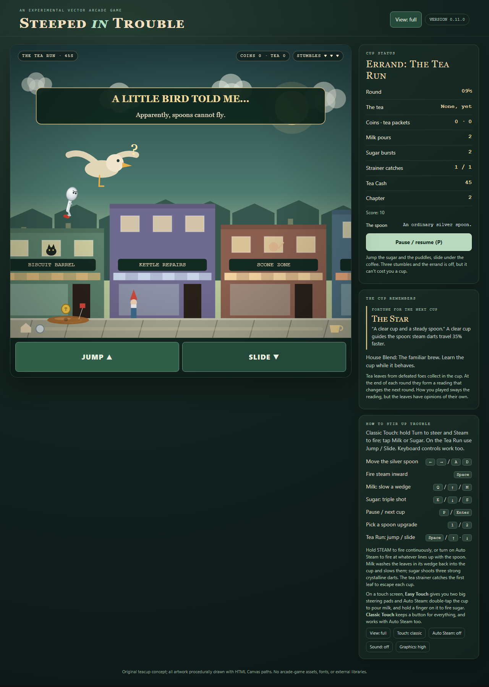
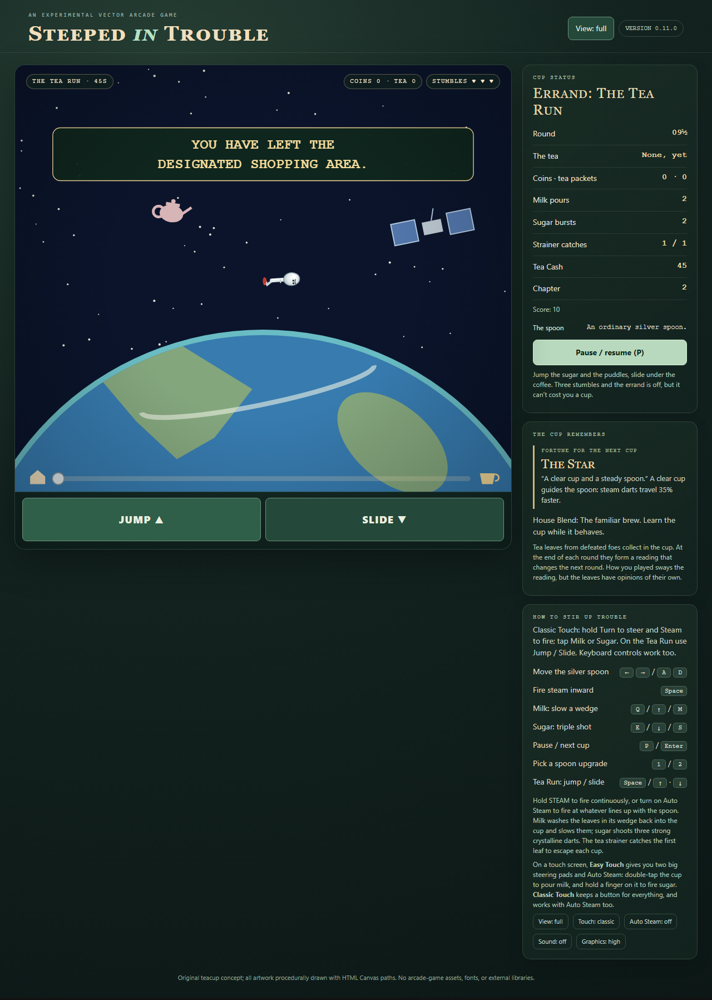
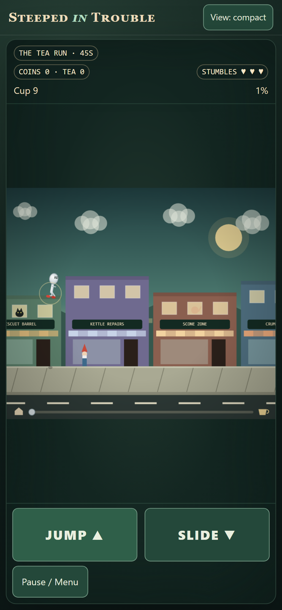
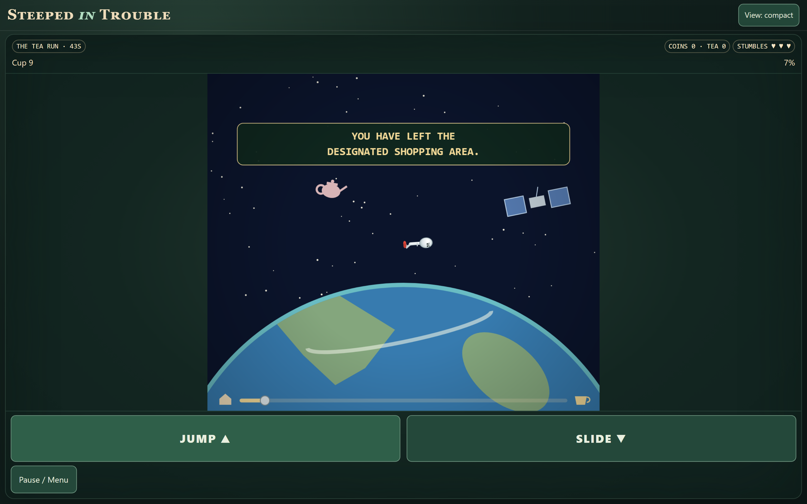

# The Flying Spoon — screenshot gallery (spoilers)

Captured from the local production build by the complete Playwright suite on
Windows, 2026-10-28. These are browser-emulated layouts, not device captures.
Desktop Full View uses Chromium at 1280 × 720; Compact layouts use mobile
Chromium at the CSS viewport sizes below, including desktop-sized Compact.
Full-page captures retain the device pixel ratio.

All listed images were opened and inspected for clipping, readable messages,
spoon/camera framing and access to controls. Secret scenes use the existing
debug state hook to force an opportunity and altitude; they are not natural
rarity samples. Jump chains use real input and the real seeded runner stream
(game seed 2). The shortage capture follows a real round-16 completion.

| Required scene | Capture |
| --- | --- |
| Normal double jump | [double-jump.png](double-jump.png) |
| Higher chain and camera | [high-chain.png](high-chain.png) |
| Failed aerial attempt (gray feedback ring) | [failed-jump.png](failed-jump.png) |
| Bird approaching and looking confused | [bird.png](bird.png) |
| Power lines, zap and silhouette | [power.png](power.png) |
| Orbit, Earth, satellite and teapot | [orbit.png](orbit.png) |
| Reentry flame | [reentry.png](reentry.png) |
| Safe sidewalk return, unchanged timer | [safe-return.png](safe-return.png) |
| Recurring shortage after round 16 | [recurring-shortage.png](recurring-shortage.png) |
| Phone portrait, 390 × 844 | [phone-portrait.png](phone-portrait.png), [bird](phone-bird.png) |
| Phone landscape, 844 × 390 | [phone-landscape.png](phone-landscape.png) |
| Tablet portrait, 800 × 1280 | [tablet-portrait.png](tablet-portrait.png) |
| Tablet landscape, 1280 × 800 | [tablet-landscape.png](tablet-landscape.png) |
| Desktop Compact, 1440 × 900 | [desktop-compact.png](desktop-compact.png) |
| Reduced-motion orbit, no rotation | [reduced-motion.png](reduced-motion.png) |

The retained portrait letterboxing comes from Milestone 1's fixed-aspect
canvas. Short landscape places large controls beside the canvas; other
Compact layouts place them below it. No mobile layout redesign accompanies
this milestone. Text remains separate from the HUD and the spoon stays in
frame. The gray ring is intentionally discreet: it does not teach the secret.

Playback provenance: `tests/browser/aerial.spec.js`, `mobile-aerial.spec.js`
and shared `aerial.js`; [test and human playtest guide](../../FLYING_SPOON_TESTING.md).

Representative previews — spoilers

